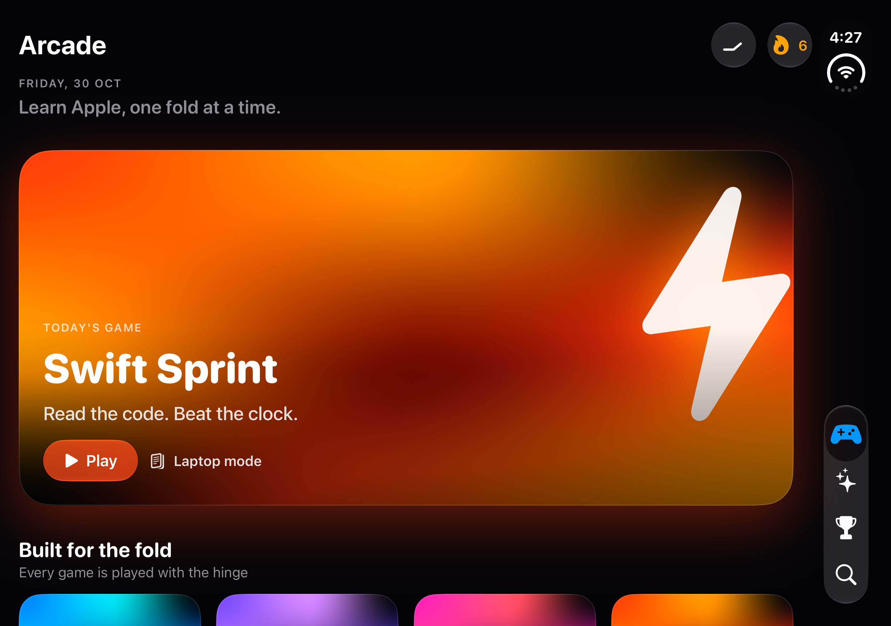

# Unfold

**Learn Apple, one fold at a time.**

Unfold is an AI-powered learning arcade for Swift, Apple frameworks and the Apple ecosystem, built for **iPhone Duo** and **iPhone 18 Pro Max**. Every game uses the hinge as a game mechanic, and an on-device Apple Intelligence coach reviews every round.



## The games

| Game | You learn | How the fold plays |
|---|---|---|
| **Fold & Flip** | Which Apple framework does what | The card turns on the same axis as the hinge. Fold past 90° to reveal the answer, unfold flat to deal the next card. Spaced repetition brings back what you missed. |
| **Time Hinge** | Fifty years of Apple history | The hinge angle sweeps a protractor from 1976 to 2026. Hold still on a year to lock it in. |
| **Data Race** | Swift concurrency and `Sendable` | The crease becomes the isolation boundary between `@MainActor` and `actor Store`. Drag only Sendable values across; a wrong move shows the real Swift 6 diagnostic. |
| **Swift Sprint** | Reading Swift code | 60 seconds of "what prints?" and "will it compile?". In laptop pose the code rises to the top half and the answers drop to the bottom. |

## What makes it different

- **Real foldable APIs.** Unfold reads iPhone Duo's hinge with iOS 27.1's `onHingeChange`, finds the crease with `reservedRegions(kind: .division)`, and moves content off the fold, following the HIG's displacement principle.
- **Presenter hinge.** A Liquid Glass slider drives the same fold state, so every fold interaction can be shown on any iPhone, the Simulator, or a projector.
- **Apple Intelligence, on device.** Coach uses FoundationModels. Answers are grounded in Unfold's curriculum, so the model can explain APIs newer than its training. Without Apple Intelligence, Coach answers from the same curriculum offline.
- **Liquid Glass where Apple says to use it**: only on navigation and controls, never on content, and never glass on glass.
- **A semantic colour system**: one meaning per colour, backed by research on colour and learning. See [Docs/DESIGN_RESEARCH.md](Docs/DESIGN_RESEARCH.md).

## Run it

1. Open `Unfold.xcodeproj` in Xcode 27.1 or later.
2. Choose the **iPhone Duo** Simulator (iOS 27.1) or **iPhone 18 Pro Max** (iOS 27.0), then press ⌘R.
3. Tap the hinge button in the Arcade toolbar to show the presenter hinge, then open a game and drag the slider to fold.

### Launch arguments for stage demos

Add these in **Product › Scheme › Edit Scheme › Run › Arguments**:

| Argument | Effect |
|---|---|
| `-demoProfile` | Loads a lived-in profile: a 6-day streak, Level 4, and partly filled mastery rings |
| `-presenterHinge` | Shows the presenter hinge at launch |
| `-presenterAngle 120` | Starts the presenter hinge at 120° |
| `-play flipCards` | Opens a game straight away: `flipCards`, `timeHinge`, `dataRace` or `sprint` |
| `-tab coach` | Opens a tab: `coach`, `journey` or `search` |

## Project layout

```
Unfold/
├── App/          UnfoldApp, Router
├── Core/         FoldState (hinge, poses, crease), FoldSplit (displacement layout)
├── Design/       Theme (worlds, palette, type), Components, CodeView
├── Model/        GameCatalog, Curriculum (all content), ProgressStore
├── AI/           Coach (FoundationModels + grounded retrieval)
├── Features/     Arcade, game detail and host, results, Coach, Journey, Search, presenter hinge
└── Games/        Fold & Flip, Time Hinge, Data Race, Swift Sprint, shared HUD
```

SwiftUI and Observation only, with no third-party dependencies. It builds with zero warnings, using Swift's default MainActor isolation.

## Pitch deck

[`Docs/Unfold-Pitch.pptx`](Docs/Unfold-Pitch.pptx) walks through the features in about five minutes, and ends with a live-demo script.
